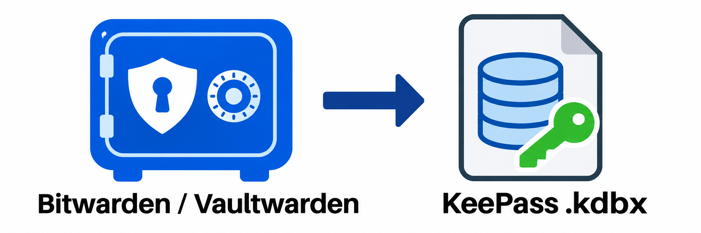

# bw2kbdx

<p align="center"></p>

Back up a **Bitwarden or Vaultwarden personal vault** to an encrypted KeePass
**`.kdbx`** file with a separate password. Preserves multiple URLs, custom fields,
and attachments using KeePassXC CLI. Runs once, verifies the result, and replaces
`backup.kdbx`; a failed run keeps the previous backup.

## Quick start

Requires Docker Compose and your personal API key from the vault's security settings.
Download these two files into your backup directory:

```sh
curl -fsSLo compose.yaml https://raw.githubusercontent.com/dermute/bw2kbdx/main/compose.yaml
curl -fsSLo .env https://raw.githubusercontent.com/dermute/bw2kbdx/main/.env.example
chmod 600 .env
mkdir -p backups
```

Edit **`.env`**: set `BW_CLIENTID`, `BW_CLIENTSECRET`, `BW_PASSWORD` (master password),
and `KDBX_PASSWORD` (separate backup password). For Vaultwarden, set `BW_SERVER`
to its HTTPS URL. Keep secrets single-quoted; escape an embedded quote as `\'`.
If your host UID/GID differs from `1000:1000`, adjust `BACKUP_UID`/`BACKUP_GID`.

```sh
docker compose pull backup
docker compose run --rm --no-deps backup
```

Open **`backups/backup.kdbx`** in KeePassXC with your backup password.

## Run regularly

For a deployment in `/opt/bw2kbdx`, choose one cron schedule (`crontab -e`):

```cron
# Daily at 03:00
0 3 * * * cd /opt/bw2kbdx && flock -n backup.lock docker compose run --rm --no-deps backup >> backup.log 2>&1

# Or every six hours
0 */6 * * * cd /opt/bw2kbdx && flock -n backup.lock docker compose run --rm --no-deps backup >> backup.log 2>&1
```

Or copy the [systemd service](examples/bw2kbdx.service) and
[daily timer](examples/bw2kbdx.timer) to `/etc/systemd/system/`, then enable them:

```sh
sudo systemctl enable --now bw2kbdx.timer
```

## More information

- [Configuration, preserved data, limitations, and recovery](docs/usage.md)
- [Development, testing, and releases](docs/development.md)
- [Validation results](VALIDATION.md)

MIT licensed; bundled tools retain their [own licenses](THIRD_PARTY_NOTICES.md).
